<div align="center">

# Blender MCP Studio

**유튜브에서 본 그 과정, 이 저장소를 받으면 말로 똑같이 할 수 있습니다.**
클로드 코드나 코덱스에 설치 프롬프트 한 장을 붙여 넣으면 블렌더·MCP·스케치팹·믹사모 연결이 끝납니다.
그다음부터는 영상에서처럼 "자동차 찾아줘", "펀치 넣어줘", "나눠서 렌더해"라고 말하면 됩니다.

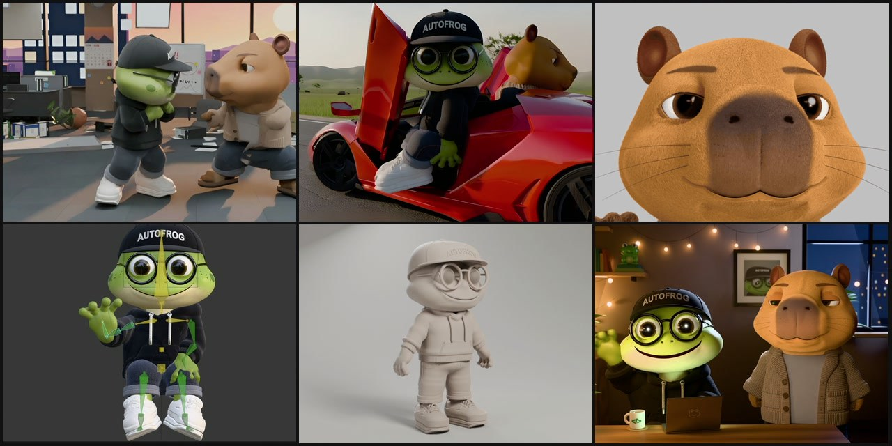

`Blender 5.2.3 LTS` · `MCP` · `Claude Code` · `Codex` · `Sketchfab API` · `Mixamo` · `Cycles 분산 렌더(Metal + OptiX)` · `TripoSG`

[English summary](#english-summary)

</div>

---

## 1. 유튜브 영상 그대로 — 말로 따라 하기

[오토프로그 유튜브](https://www.youtube.com/@autofrogkr)의 "말로 만든 3D 캐릭터" 제작기는 블렌더를 한 번도 손으로 만지지 않고 클로드 코드에게 말로만 시켜 만든 기록입니다. 그때 쓴 연결과 도구를 이 저장소에 담았습니다. 받아서 설치하면 영상 장면을 같은 말로 따라 할 수 있습니다.

| 영상 장면 | 클로드 코드·코덱스에 하는 말 (예) | 이 저장소에서 쓰이는 것 |
|---|---|---|
| 블렌더와 클로드 코드, MCP 연결 4분 | `INSTALL_PROMPT.md` 0번 상자 붙여 넣기 | 설치 스크립트 → 블렌더 5.2.3·블렌더 MCP·`studio` 설치, 클로드·코덱스 등록 |
| 그림을 주니까 달라졌다 — 캐릭터 시트 | "이 캐릭터 시트대로 블렌더에서 만들어 줘" | 블렌더 MCP(클로드가 블렌더 코드를 직접 짜서 실행) |
| 자러 가기 전에 캡처 던져 두기 · 47번 더 고치기 | "화면 캡처해서 시트랑 다른 곳 찾아 고쳐 줘" | `blender_screenshot` → 클로드가 그림을 보고 다시 고침 |
| 뼈대 심고 움직이기 | "이 캐릭터에 믹사모로 뼈 넣고 걷기 동작 붙여 줘" | `mixamo_rig` · `mixamo_animate` (자동 리깅 + 동작 붙이기) |
| 말로 만든 자동차 광고 | "빨간 스포츠카 찾아줘" → "1번 4.5m로 가져와" | `sketchfab_search`(추천 썸네일 한 장) · `sketchfab_import`(출처 자동 기록) |
| 말로 만든 직장인 철권 | "두 캐릭터에 펀치·막기 동작 넣어 줘" | `mixamo_search` · `mixamo_animate` |
| 최종 렌더 | "맥이랑 윈도우로 나눠서 렌더해 줘" | `render_plan` · `render_distributed` (기기 속도대로 나눠 그리고 이어 붙임) |

> 솔직하게: 스케치팹·믹사모·렌더는 말 한마디로 끝납니다. 캐릭터 모델링은 클로드가 매번 코드를 새로 짜기 때문에 결과가 영상과 똑같지 않습니다. 영상 속 캐릭터도 캡처를 보고 "여기 고쳐"를 수십 번 되풀이해서 나왔습니다. 그 반복을 말로 할 수 있게 해 주는 게 이 저장소입니다.

### 그렇게 만든 장면들

오토프로그(개구리)와 카피 선배(카피바라), 그리고 둘이 나오는 짧은 영상들입니다. **모델링은 손으로 한 번도 하지 않았습니다.** 사람은 말로 지시하고 결과를 보고 고칠 점을 말했을 뿐, 블렌더 조작은 AI 에이전트가 MCP로 했습니다.

| 사무실 격투 (30초 영상) | 스포츠카 광고 |
|---|---|
| 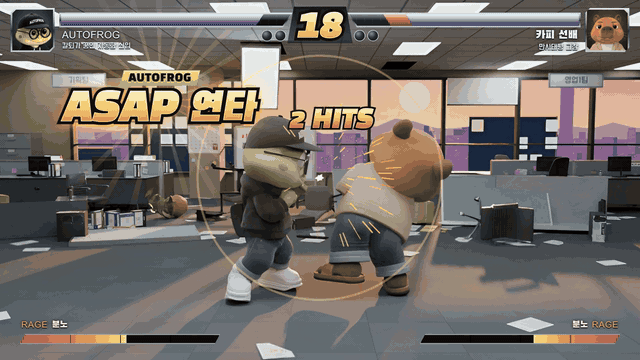 | 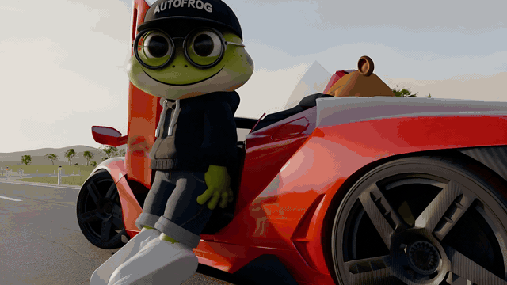 |
| **점토 모형 → 완성본** | **카피바라 벨벳 털 클로즈업** |
| 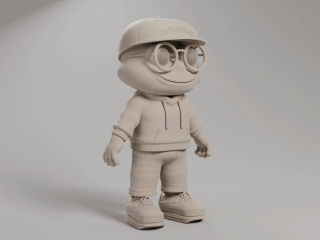 | 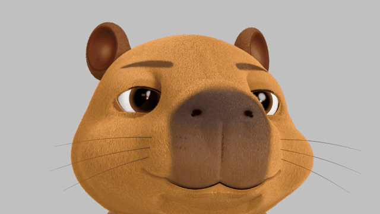 |
| **모션그래픽 합성** | **블렌더 화면 — AI가 직접 만지는 모습** |
| 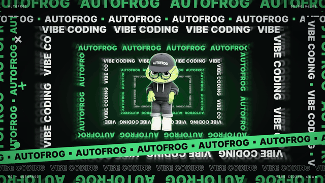 | 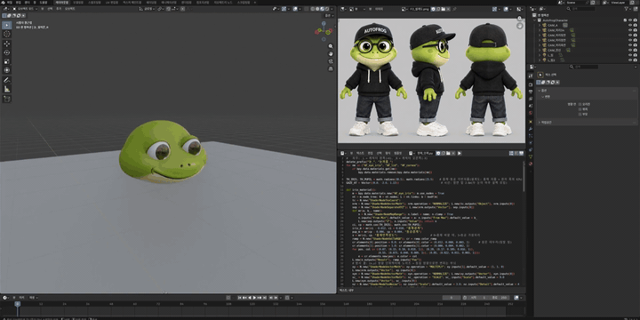 |

기록으로 남은 숫자 (제작 일지 자동 집계, 2026-09-26 ~ 10-22):

| 지시 횟수 | 걸린 시간 | 블렌더 MCP 첫 연결 | 맥+윈도우 분산 렌더 구축 |
|---|---|---|---|
| **348번** | **187.5시간** | **4분** | **48분** |

<sub>걸린 시간 = 지시를 받은 때부터 AI가 마지막으로 답한 때까지. 사람이 결과를 보고 생각한 시간은 뺐습니다.</sub>

---

## 2. 무엇이 들어 있나

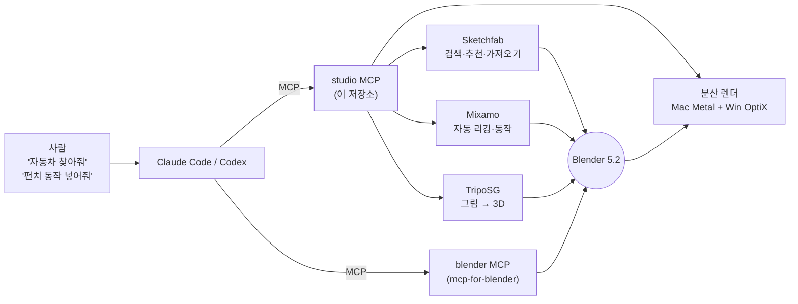

| 하는 일 | 사람이 하는 말 (예) | 실제로 일어나는 일 |
|---|---|---|
| 설치·연결 | `INSTALL_PROMPT.md` 0번 붙여 넣기 | 블렌더 5.2.3, uv, 블렌더 MCP 애드온, `studio` 설치 → 클로드·코덱스에 MCP 등록 |
| 계정 연동 | "스케치팹 연결해 줘" | 가입 페이지 열기 / 로그인 창 → 토큰 자동 저장(값은 화면에 절대 안 나옴) |
| 에셋 찾기 | "빨간 스포츠카 찾아줘" | 받을 수 있는 모델만, 라이선스·면 수·인기로 점수 → **썸네일 시트**로 추천 |
| 가져오기 | "3번 4.5m로 가져와" | 다운로드 → 블렌더로 가져와 바닥·크기 맞춤 → `credits.json`에 출처 기록 |
| 리깅·동작 | "이 캐릭터에 펀치 동작 넣어줘" | 믹사모 자동 리깅 → 동작 검색·내보내기 → 블렌더 캐릭터에 붙이기 |
| 그림 → 3D | "이 캐릭터 그림을 3D로" | 로컬 GPU에서 이미지→3D → 닫힌 메시 검사 → 블렌더로 |
| 렌더 | "맥이랑 윈도우로 나눠서 렌더해" | 기계별 실측 속도로 프레임 배분 → 동시에 렌더 → 이어 붙이기 |

---

## 3. 빠른 시작 — 프롬프트 한 장

```bash
git clone https://github.com/d-onworks/blender-mcp-studio.git
cd blender-mcp-studio
claude      # 또는 codex
```

그리고 [`INSTALL_PROMPT.md`](INSTALL_PROMPT.md)의 **0번 상자**를 통째로 붙여 넣으면 됩니다. 에이전트가 운영체제를 확인하고, 할 일을 먼저 보여 준 뒤 설치하고, `studio status`로 스스로 확인합니다.

손으로 하고 싶다면:

```bash
bash install/install_mac.sh                                          # 맥
powershell -ExecutionPolicy Bypass -File install\install_win.ps1     # 윈도우
studio status
```

설치 뒤에는 클로드 코드/코덱스를 한 번 껐다 켜야 MCP 도구가 보입니다.

윈도우에 `winget`이 없어도 공식 zip을 받아 해시를 맞춰 보고 깝니다. 이미 깐 블렌더가 있으면 `-BlenderPath "경로\blender.exe"`로 알려 주면 됩니다.

---

## 4. 단계별 안내

| 단계 | 문서 | 핵심 |
|---|---|---|
| 1 | [블렌더 설치](docs/01_블렌더설치.md) | 5.2.3 LTS, 공식 해시 대조 |
| 2 | [블렌더 MCP](docs/02_블렌더MCP.md) | `mcp-for-blender` 애드온, 소켓 9876, 자주 막히는 곳 |
| 3 | [클로드·코덱스 연결](docs/03_클로드코덱스연결.md) | `claude mcp add` / `codex mcp add`, 코덱스 시간 제한 600초 |
| 4 | [스케치팹](docs/04_스케치팹.md) | 가입·로그인 연동, 추천 검색, 가져오기, CC-BY 출처 표기 |
| 5 | [믹사모](docs/05_믹사모.md) | 무료 가입, 자동 리깅, 동작 붙이기 |
| 6 | [분산 렌더](docs/06_분산렌더.md) | 맥 + 윈도우 GPU 나눠 렌더, 실측 그래프 |
| 7 | [TripoSG 그림→3D](docs/07_TripoSG.md) | 로컬 RTX 이미지→3D, 라이선스 주의 |

### 스케치팹 — "자동차 찾아줘"

검색 결과를 번호·이름·라이선스가 적힌 썸네일 한 장으로 보여 주고, 고른 모델을 블렌더로 가져옵니다. 출처 문구는 자동으로 기록됩니다.

```text
studio sketchfab search "sports car" --count 8
studio sketchfab import 3 --size 4.5
```

### 믹사모 — "펀치 동작 넣어줘"

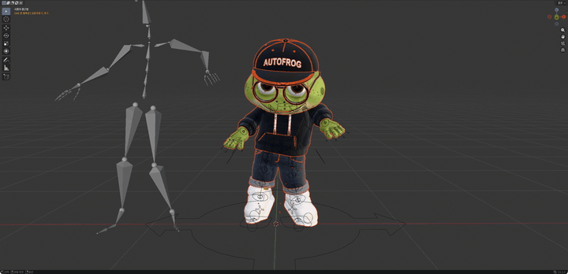 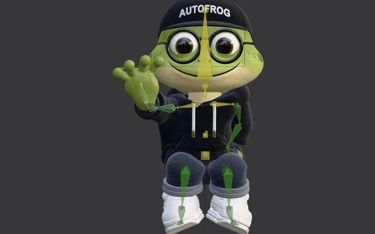

리그 없는 캐릭터는 믹사모에 올려 자동 리깅하고, 이미 리그가 있으면 동작만 받아 붙입니다. 믹사모 로그인은 브라우저 창에서 한 번만 하면 됩니다.

> 미리 알아 두세요: 믹사모는 공개 API가 없어서, 믹사모 웹사이트가 쓰는 비공식 API를 본인 로그인으로 부릅니다. 어도비가 바꾸면 예고 없이 깨질 수 있고, 사용은 본인 계정과 어도비 이용약관 안에서 하셔야 합니다. 로그인 토큰은 내 컴퓨터(`~/.blender-mcp-studio/`, 본인만 읽기 권한)에만 저장되고 어디로도 보내지 않습니다.

| 개구리 뼈대 | 카피바라 뼈대 (손가락까지) |
|---|---|
| 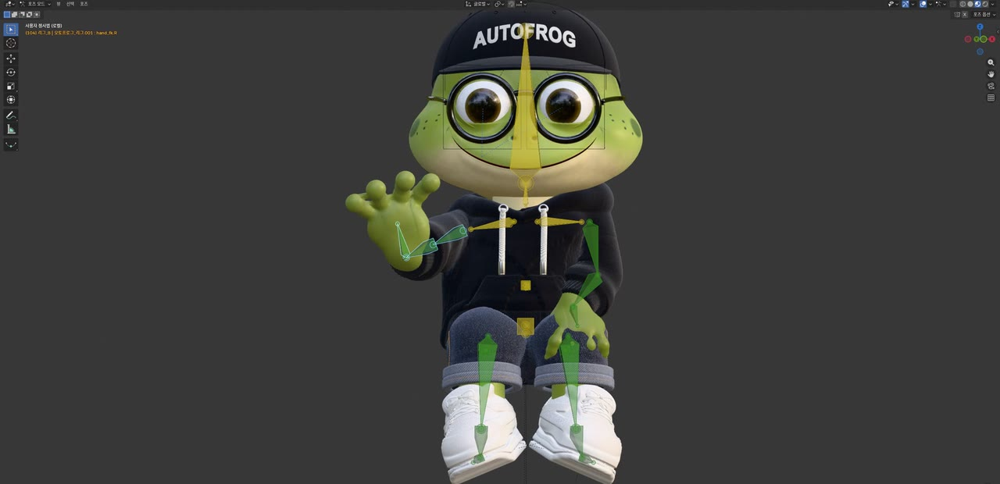 | 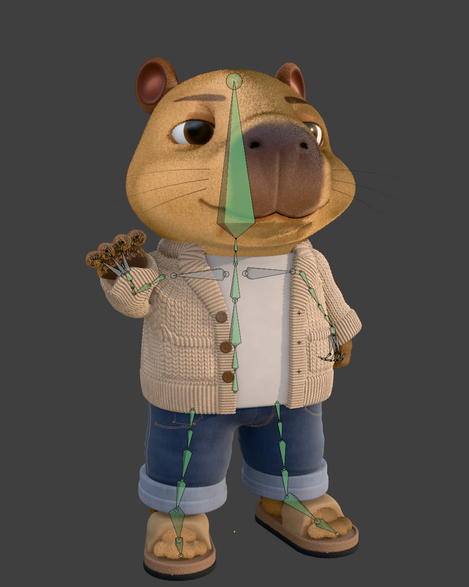 |

---

## 5. 분산 렌더 — 맥과 윈도우가 나눠서

맥 스튜디오(M4 Max, Metal)와 집 윈도우 PC(RTX 3080 10GB, OptiX)가 한 장면의 프레임을 나눠 맡습니다. 기계별 실측 장당 속도로 구간을 나누고, 먼저 끝난 쪽이 남은 꼬리를 가져옵니다.

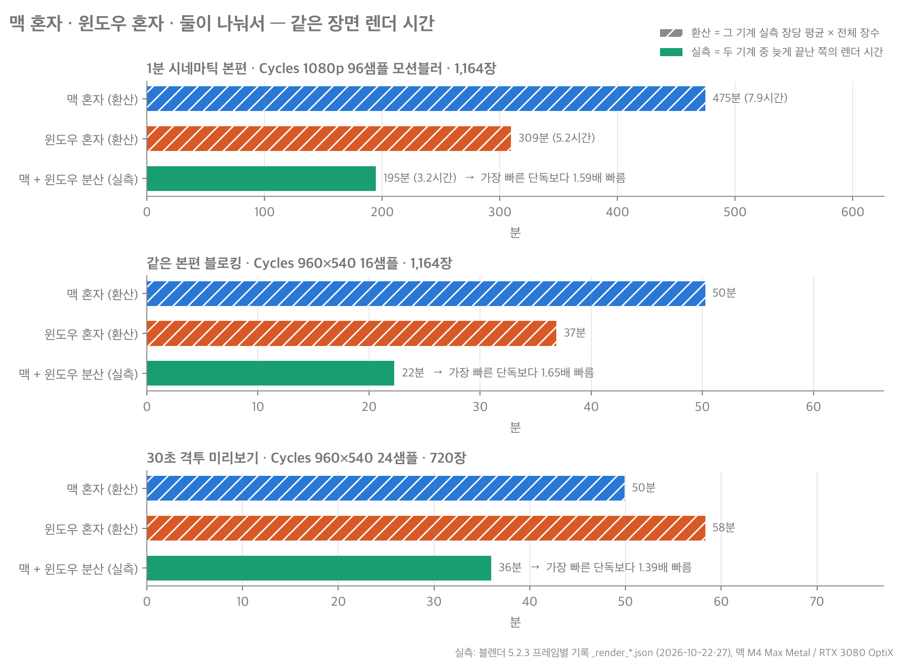

- 1분 시네마틱(1080p, Cycles 96샘플, 모션블러, 1,164장): **분산 195분** — 가장 빠른 한 대보다 **1.59배** 빠름
- 숫자는 전부 블렌더 프레임별 기록에서 뽑았습니다. "혼자" 막대는 실측 장당 평균 × 전체 장수로 환산한 값이라 빗금으로 구분했습니다. 근거 = [`media/charts/DATA.md`](media/charts/DATA.md)

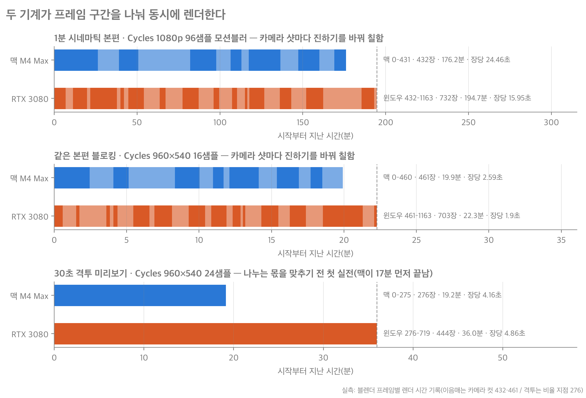

<details>
<summary>렌더 설정별 장당 시간 · 윈도우 VRAM 기록</summary>

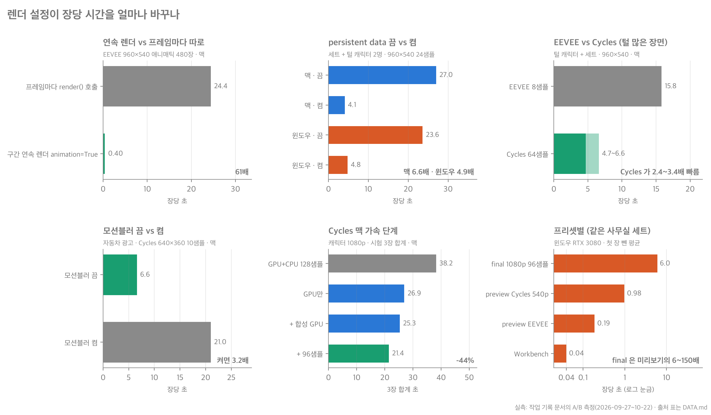
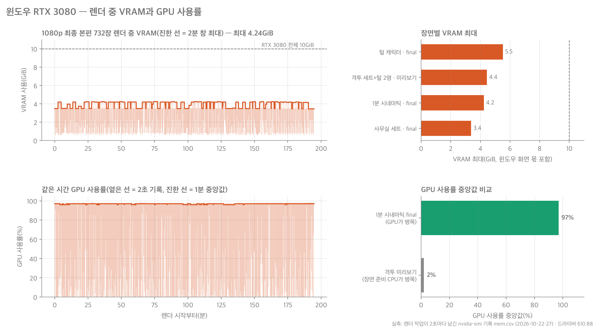

</details>

---

## 6. 그림 한 장 → 3D (TripoSG)

캐릭터 그림 한 장을 로컬 GPU에서 3D 바탕 모델로 뽑고, 닫힌 메시인지 검사해 블렌더로 가져옵니다. 10GB 카드(RTX 3080)에서는 depth 9가 한계입니다(depth 10은 VRAM이 넘쳐 멈춘 것처럼 보임).

> ⚠️ **라이선스 주의** — TripoSG 저장소 최상위는 MIT지만, 핵심 코드 폴더(`triposg/`)는 Tencent Hunyuan FlashVDM 커뮤니티 라이선스이며 사용 지역에서 **대한민국·EU·영국을 제외**합니다. 이 저장소는 TripoSG 코드·가중치를 포함하지 않고 호출 방법만 안내합니다. 해당 지역이거나 상업용이면 TRELLIS(MIT)나 유료 Tripo3D API를 검토하세요. 자세히 = [docs/07_TripoSG.md](docs/07_TripoSG.md)

---

## 7. 우리가 실패한 것 (그래서 이렇게 짰다)

- **사람 캐릭터의 애니풍 머리카락은 코드(SDF·곡선 다발)로 7번 시도해 모두 실패했습니다.** 헬멧, 버섯, 가시 모양이 됐습니다. 사람형은 이미지→3D(유료 Tripo3D)로 바탕을 뽑는 쪽이 훨씬 낫습니다. 개구리·카피바라 같은 덩어리형만 코드 모델링이 잘 맞습니다.
- 시트 그림을 3D 모델에 투영해 색을 입히면 머리카락 색이 얼굴에 묻었습니다.
- 렌더에서 모션블러를 끄면 24fps가 12fps처럼 끊겨 보였습니다. 기본값은 켜 두었습니다.
- 블렌더를 파일 인자로 열면 MCP 소켓 서버가 안 뜹니다. 빈 블렌더를 연 뒤 파일을 여는 방식으로 우회합니다.

---

## 8. 저작권·출처

- 이 저장소의 코드·문서: [MIT](LICENSE) © D-ON WORKS
- **모델·동작 파일은 넣지 않았습니다.** 믹사모 동작과 스케치팹 모델은 각자 계정으로 받습니다. 믹사모는 원본 재배포가 금지이고, 스케치팹은 모델마다 라이선스가 다릅니다(CC-BY는 출처 표기 필수 — `studio`가 `credits.json`에 자동 기록).
- 오토프로그·카피 선배 캐릭터와 이 저장소의 그림·움짤은 D-ON WORKS 소유입니다. 홍보용으로 보여 드리는 것이며 캐릭터 재사용은 허락하지 않습니다.
- 움짤 속 외부 에셋 출처와 제3자 도구 목록 = [NOTICE.md](NOTICE.md)

만든 곳: **D-ON WORKS · 오토프로그** — 질문·제안은 이슈로 남겨 주세요.

---

## English summary

**Blender MCP Studio** packages the setup behind our YouTube making-of series ([@autofrogkr](https://www.youtube.com/@autofrogkr)), where every 3D scene was made by talking to Claude Code — no hands on Blender. Clone it, paste one install prompt into Claude Code or Codex, and you can repeat the same steps by voice: find a car on Sketchfab, auto-rig a character on Mixamo and add a punch, render across a Mac and a Windows PC.

- One-shot natural-language install prompt (`INSTALL_PROMPT.md`) for macOS and Windows: Blender 5.2.3 LTS, uv, the `mcp-for-blender` add-on, and this repo's `studio` MCP server.
- `studio` MCP tools: Sketchfab search with a ranked thumbnail contact sheet and one-step import (credits recorded), Mixamo auto-rig and animation import, local image-to-3D (TripoSG), and Mac (Metal) + Windows (OptiX) distributed Cycles rendering — measured 1.59× faster than the fastest single machine on a 1,164-frame 1080p shot.
- No models or animation files are included; users fetch them with their own accounts. TripoSG's core code is under a license that excludes South Korea, the EU and the UK — see `docs/07_TripoSG.md`.
