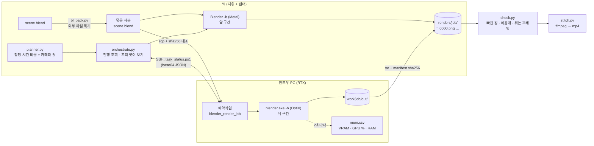

# 06. 분산 렌더 — 맥 + 윈도우 PC 두 대로 나눠 굽기

> 애플 실리콘 맥(Metal)과 엔비디아 RTX 윈도우 PC(OptiX)가 한 장면의 프레임을 나눠 동시에 렌더한다.
> 1080p Cycles 최종 1,164장을 **194.7분**에 끝냈다. 같은 장면을 맥 혼자 돌리면 약 475분, 윈도우 혼자 돌리면 약 309분 걸리는 양이다.
> 이 문서의 숫자는 모두 실제 렌더 기록에서 가져왔다. 값과 출처는 [`media/charts/DATA.md`](../media/charts/DATA.md)에 있다.

코드: [`studio_mcp/render/`](../studio_mcp/render/) (패키지 본체) · [`scripts/render/distrender.py`](../scripts/render/distrender.py) (저장소에서 바로 쓰는 입구)
한 줄 실행은 `python -m studio_mcp.render dist scene.blend --job shot01 --preset final --steal` · MCP 도구로는 `render_plan(...)`, `render_distributed(...)`

---

## 1. 왜 나누나

집에 GPU가 두 개 있으면 한 장면을 둘이 나눠 렌더할 수 있다. 블렌더는 장면을 프레임 단위로 렌더하니 앞 구간과 뒤 구간을 다른 기계에 맡기고, 결과 PNG만 모으면 된다.

이론은 단순한데 실제로 해 보면 막히는 데가 많다.

- **두 기계 속도가 다르다.** 같은 1080p 프레임을 RTX 3080 은 15.86초, M4 Max 는 26.08초에 그렸다(같은 6장, 1.64배 차이). 반반 나누면 빠른 쪽이 한참 논다.
- **속도 차이가 장면마다 뒤집힌다.** GPU가 일하는 최종 렌더는 윈도우가 빠르지만, 장면을 다시 읽는 CPU 일이 대부분인 미리보기는 맥이 빨랐다(장당 4.16초 vs 4.86초).
- **이음매가 보이면 안 된다.** 두 기계의 그림이 조금이라도 다르면 넘어가는 프레임에서 티가 난다.
- **윈도우를 원격으로 오래 돌려야 한다.** SSH 연결이 끊기면 렌더도 같이 죽는다.

`studio_mcp/render/` 는 이 넷을 순서대로 푼다. 기계별 장당 시간으로 몫을 정하고, 경계를 카메라 컷에 붙이고, 같은 묶음 파일과 같은 버전으로 그림을 맞추고, 윈도우에서는 데스크톱 세션 예약작업으로 돌린다.


## 2. 구조



| 파일 | 하는 일 |
|---|---|
| `cli.py` | 터미널 입구(`python -m studio_mcp.render`). `plan`·`pack`·`dist`·`probe`·`status`·`clean`·`check`·`stitch` |
| `api.py` | MCP·`studio` 명령용 함수 `render_plan` · `render_distributed` · `render_job_status`. 한국어 키 dict 를 돌려주고, 진행 글이 표준 출력(MCP 통신 통로)으로 새지 않게 붙잡는다 |
| `planner.py` | 모든 기계가 동시에 끝나도록 장수를 나누고, 경계를 가까운 카메라 컷으로 옮긴다. 블렌더·SSH 없이 도는 순수 계산 |
| `orchestrate.py` | 모든 기계를 한꺼번에 시작하고 진행을 본다. `--steal` 이면 먼저 끝난 로컬 기계가 남은 기계의 마지막 프레임부터 거꾸로 가져온다 |
| `workers.py` | 기계 3종: `LocalWorker`(이 컴퓨터) · `WinWorker`(SSH 윈도우) · `SimWorker`(블렌더 없이 흉내) |
| `remote_win.py` | SSH·scp·PowerShell. 명령은 `.ps1`(UTF-8 BOM)로 올려 실행하고 결과는 base64 로 받는다 |
| `blender/bl_pack.py` | 이미지·글꼴·링크 라이브러리를 `.blend` 안에 묶은 사본을 만든다. 묶이지 않는 것(이미지 시퀀스·동영상·Alembic·디스크 캐시)은 경고 |
| `blender/bl_render_range.py` | 두 기계 공용 렌더 스크립트. 프리셋 적용 → `animation=True` 연속 렌더 → 장마다 `[WR] frame= sec=` 기록 |
| `blender/bl_gpu_probe.py` | Cycles 장치(Metal·OptiX·CUDA·HIP·oneAPI) 목록과 엔진별 시험 렌더 |
| `win/task_*.ps1` | 윈도우 예약작업 시작·상태·정리. 다른 렌더가 돌고 있으면 `GPU_BUSY` 로 거부 |
| `check.py` · `stitch.py` | 회수 뒤 검증, PNG 연번을 mp4 로 |

### 몫 나누기

기계 i 의 장당 시간을 `sec_i`, 블렌더 띄우기와 첫 장 준비 시간을 `startup` 이라 하면, 모두 같은 시각 T 에 끝나는 장수는 이렇다.

```
T   = (N + Σ startup/sec_i) / Σ(1/sec_i)
n_i = (T − startup) / sec_i
```

장당 시간은 ①명령줄 `--speed mac=24.4` ②지난 분산 렌더에서 배운 값(`~/.blender-mcp-studio/render/speed.json`, 프리셋별) ③설정 파일 순서로 고른다. 렌더가 끝날 때마다 기계별로 첫 장을 뺀 평균을 다시 적어 두므로, 같은 프리셋은 돌릴수록 몫이 맞아 간다.

비율로 나온 경계에서 가장 가까운 카메라 컷이 전체 길이의 25% 안에 있으면 경계를 그 컷으로 옮긴다. 컷 자리는 화면이 원래 바뀌기 때문에 기계 사이에 아주 작은 차이가 있어도 보이지 않는다. 카메라 컷은 장면의 타임라인 마커 중 카메라가 묶인 것을 `bl_pack.py` 가 읽어 온다.

### 꼬리 뺏어 오기 (`--steal`)

몫을 잘 나눠도 샷마다 무게가 달라 한쪽이 먼저 끝난다. 1080p 본편에서 맥은 176.2분, 윈도우는 194.7분에 끝났다. 로고 오프닝(유체 불꽃)은 앞쪽 프레임이 가벼워 맥 14.2분, 윈도우 30.3분으로 더 크게 벌어졌다.
그때 사내에서는 맥이 윈도우의 남은 구간을 **끝 프레임부터 거꾸로** 렌더하다가 둘이 만나는 곳에서 멈추게 했다. `--steal` 은 이 방법을 자동으로 한다.

- 조각 크기 = `steal_chunk_sec`(기본 120초) ÷ 도둑 장당 시간. 조각마다 블렌더를 새로 띄우므로 너무 잘게 자르지 않는다.
- 피해 기계가 곧 닿을 프레임(조회 간격 2번 분량 + 1장)은 건드리지 않는다.
- 도둑 조각이 피해 기계보다 늦게 끝날 것 같으면 가져오지 않는다.
- 둘이 같은 프레임을 그려도 결과는 같다(4절). 겹치면 시간만 조금 버린다.

공개판 `--steal` 은 아직 실제 렌더로 돌려 보지 않았다. 대신 `--simulate` 로 흐름을 확인했다. 계획보다 맥이 빠르고(24.45 → 18초) 윈도우가 느린(15.96 → 17초) 경우를 흉내 내면, 뺏어 오기가 없을 때 200.0분, 있을 때 186.7분이 나온다(맥이 윈도우 꼬리를 54~57장 가져옴 — 흉내의 시간 오차로 회차마다 조금 다르다). 이 숫자는 흉내 결과라서 실측 그래프에는 넣지 않았다.
2026-10-28 공개판 끝까지 시험(tests/e2e/E2E_REPORT.md)에서는 단순 시험 장면 48장(960×540, 8샘플)을 실제로 맥+윈도우가 `--steal` 로 나눠 돌렸다. 묶기·전송(해시 일치)·예약작업·회수(해시 불일치 0)·검증(빠진 장 0, 이음매 티 안 남)·속도 학습까지 통과했고, 두 기계가 거의 같이 끝나 뺏어 오기는 일어나지 않았다.


## 3. 준비

### 윈도우 PC

1. **OpenSSH 서버**를 켠다(설정 → 시스템 → 선택적 기능 → OpenSSH 서버). 맥에서 비밀번호 없이 들어가도록 공개키를 넣는다. 관리자 계정이면 `C:\ProgramData\ssh\administrators_authorized_keys` 에 넣어야 한다.
2. 맥의 `~/.ssh/config` 에 별칭을 하나 만든다.
   ```
   Host render-pc
       HostName 192.168.0.20     # 예시 값
       User renderuser           # 예시 값
   ```
   `ssh render-pc hostname` 이 비밀번호 없이 돌아오면 된다.
3. **블렌더를 맥과 같은 버전으로** 설치한다. 우리는 둘 다 5.2.3 LTS 다. 윈도우는 설치 프로그램 대신 공식 zip 을 풀어 `C:\render\blender\blender-5.2.3\` 처럼 둔다. 버전이 다르면 같은 파일이라도 결과가 달라진다.
4. 렌더를 맡길 계정으로 **데스크톱에 로그인해 둔다.** 렌더는 그 사용자의 대화형 예약작업으로 돈다. 로그인한 사람이 없으면 `NO_DESKTOP_USER` 로 멈춘다.
5. 밤샘 렌더를 할 거면 절전·최대 절전을 끈다.

### 맥

```bash
mkdir -p ~/.blender-mcp-studio
cp studio_mcp/render/render_config.example.json ~/.blender-mcp-studio/render_config.json   # host·root·blender_exe 를 고친다
python -m studio_mcp.render probe                    # 두 기계의 GPU 장치·VRAM 확인
```

호스트·경로·계정은 이 설정 파일에만 둔다(저장소 밖). 설정 파일을 찾는 순서는 환경변수 `STUDIO_RENDER_CONFIG` → `~/.blender-mcp-studio/render_config.json` → `scripts/render/render_config.json`(gitignore) 이다.
맥 블렌더 경로는 비워 두면 `/Applications/Blender.app`, 윈도우 `Program Files\Blender Foundation`, `PATH` 순으로 찾는다.
설정이 없어도 `plan`·`--dry-run`·`--simulate` 는 예시 설정(우리 장비 실측 장당 시간)으로 돈다.

`probe` 결과 예시(우리 장비, 2026-10-22·28 실측):

| 기계 | 블렌더가 잡은 장치 | 시험 렌더 320×180 |
|---|---|---|
| 맥 | METAL: Apple M4 Max (GPU - 32 cores) | — |
| 윈도우 | OPTIX: RTX 3080 · CUDA: RTX 3080 · oneAPI: Intel(R) Graphics · METAL: 이 빌드에 없음 | OptiX 0.38초 · CUDA 0.30초 · Workbench 0.60초 · EEVEE 0.79초 · GPU 합성 0.87초 |

윈도우 `probe` 는 `nvidia-smi` 로 전체 VRAM·사용 중·드라이버(우리는 10,240MiB · 610.88)도 함께 보여 준다.

## 4. 실행

```bash
# 1) 계획부터 본다 — 블렌더도 SSH 도 쓰지 않는다
python -m studio_mcp.render plan --scene-info studio_mcp/render/examples/scene_info.example.json --preset final

# 2) 실제로 할 단계를 확인한다
python -m studio_mcp.render dist shot.blend --job shot01 --preset final --steal --dry-run

# 3) 돌린다: 묶기 → 보내기 → 동시 렌더 → 회수 → 검증 → 속도 학습
python -m studio_mcp.render dist shot.blend --job shot01 --preset final --steal

# 4) 영상으로
python -m studio_mcp.render stitch renders/shot01 -o shot01.mp4 --audio mix.wav
```

클로드 코드·코덱스에서는 MCP 도구로 같은 일을 한다.

| 도구 | 하는 일 |
|---|---|
| `render_plan(frames, preset, cuts, scene_info, step, speeds, snap)` | 계획만. `구간`(기계·시작·끝·장수·몫·장당_초·예상_분·경계), `예상_분산_분`, `혼자_예상_분`, `가장_빠른_단독_대비_배수`, `경고`, `계획표` |
| `render_distributed(blend, job, preset, …, steal=True, dry_run=False, simulate=False, background=True)` | 실제 렌더는 기본으로 백그라운드 프로세스로 띄우고 `PID`·`로그` 를 바로 돌려준다(몇 시간짜리 작업이라). `dry_run`·`simulate` 는 그 자리에서 결과를 돌려준다 |
| `render_job_status(job)` | 백그라운드 작업의 `도는_중`, `로그_끝`, 끝났으면 `결과` |

`plan` 출력(위 1번, 우리 1분 시네마틱의 실제 카메라 컷 41개와 설정 파일의 실측 장당 시간으로):

```
기계  프레임    장수   몫     장당  속도 출처      예상  경계
----  --------  ----  ---  -------  ---------  --------  -----------------------------
mac   0-460      461  40%  24.45초  설정 파일  3.14시간  시작
win   461-1163   703  60%  15.96초  설정 파일  3.12시간  카메라 컷 461 (비율 지점 460)

분산 예상 3.14시간  ·  혼자 돌리면 mac 7.91시간 / win 5.17시간  →  가장 빠른 기계(win) 혼자보다 1.65배
```

실제 본편은 경계 432(역시 카메라 컷)에서 나눠 194.7분에 끝났다.

| 프리셋 | 내용 |
|---|---|
| `final` | Cycles 1920×1080 · 96샘플 · 적응 샘플링 · OIDN(GPU) · 라이트 트리 · 모션블러 Center 0.5 · GPU만 |
| `preview` | Cycles 960×540 · 16샘플 · OIDN · 모션블러 끔 · Simplify |
| `preview-eevee` | EEVEE 960×540 · 8샘플 · 레이트레이싱·볼륨·모션블러·글레어 끔 |
| `preview-workbench` | Workbench 960×540 |
| `keep` | 파일 설정 그대로(장치·구간·출력만 바꿈) |

프리셋 위에 `--res 640x360 --samples 8 --mblur 0 --persistent 1` 처럼 덮어쓸 수 있다.

그 밖의 명령:

- `--simulate` — 블렌더·SSH 없이 장당 시간만으로 전체 흐름을 흉내 낸다. `--sim-actual mac=18` 로 계획과 다른 실제 속도를 주면 `--steal` 이 어떻게 움직이는지 볼 수 있다.
- `status --job X` / `clean --job X [--kill]` — 윈도우 예약작업 상태·정리.
- `check renders/X --frames 0-1163 --seams 432` — 빠진 장, 이음매 밝기 차이, 갑자기 튀는 프레임.

## 5. 실측 결과

### 분산 3건

| 작품 · 설정 | 장수 | 맥 | 윈도우 | 분산 | 가장 빠른 단독(환산) 대비 |
|---|---|---|---|---|---|
| 1분 시네마틱 본편 · Cycles 1080p 96샘플 · 모션블러 | 1,164 | 0–431, 176.2분 | 432–1163, 194.7분 | **194.7분** | 1.59배 |
| 같은 본편 블로킹 · Cycles 960×540 16샘플 | 1,164 | 0–460, 19.9분 | 461–1163, 22.3분 | **22.3분** | 1.65배 |
| 30초 격투 미리보기 · Cycles 960×540 24샘플 | 720 | 0–275, 19.2분 | 276–719, 36.0분 | **36.0분** | 1.39배 |

- '단독(환산)'은 그 기계가 맡은 구간의 실측 장당 평균에 전체 장수를 곱한 값이다. 한 기계로 끝까지 돌린 기록은 없다.
- 격투 미리보기는 몫을 맞추기 전 첫 실전이었다. 반반에 가깝게 나눴는데 이 장면은 맥이 더 빨라서 맥이 16.8분 먼저 끝났다. 속도 학습이 다음 몫을 0.46(윈도우 46%)으로 내렸다.
- 본편 전송 125MB 6초, 회수 733개 22초, 해시 불일치 0, 빠진 장 0.

### 두 기계 그림이 같은가

사무실 세트 f300 final 을 맥 Metal 과 윈도우 OptiX 로 같은 묶음 파일에서 렌더해 비교했다.

| 비교 | 결과 |
|---|---|
| 픽셀 평균 차이 | 0.34 / 255 |
| 차이 2 이하 픽셀 | 99% |
| 평균 밝기 | 112.65 vs 112.78 |
| 노이즈 크기 | 2.03 vs 2.02 |

나란히 놓아도 구별되지 않았다. 다른 곳은 얇은 반사 가장자리 몇 픽셀뿐이었다. 같은 장면의 EEVEE 미리보기(f1)는 평균 차이 0.23/255 였다.
이렇게 맞추려면 네 가지가 같아야 한다. 같은 묶음 사본, 같은 블렌더 버전, `--factory-startup`, OIDN 디노이저다. OptiX 디노이저는 엔비디아에서만 돌아 결과가 달라지므로 쓰지 않는다.

### 설정이 장당 시간을 얼마나 바꾸나


- 프레임마다 `render()` 를 따로 부르면 연속 렌더(`animation=True`)보다 61배 느렸다(EEVEE 애니매틱 장당 24.4초 vs 0.40초). 프레임마다 GPU 에 장면을 다시 올리기 때문이다.
- 큰 세트에 털 캐릭터가 둘 있는 장면에서 persistent data 를 끄면 장당 27초가 걸렸고, 그동안 GPU 사용률은 3%였다. 켜면 4.08초가 된다.
- 털이 많은 장면은 EEVEE 가 Cycles 보다 느렸다(15.8초 vs 4.7~6.6초).
- 맥 Cycles 는 CPU 를 끄고 GPU 만 쓰는 것만으로 30% 빨라졌다. 그림은 같았다.

### 윈도우 GPU 메모리


- 1080p 최종 본편 732장을 렌더하는 동안 VRAM 은 최대 4.24GiB 로, 10GiB 안에 넉넉히 들어갔다. 털 캐릭터(약 90만 가닥) 최종은 5.5GiB 까지 올라갔다.
- 같은 RTX 3080 이라도 GPU 사용률은 장면마다 다르다. 본편 최종은 중앙값 97%, 격투 미리보기는 2%였다. 사용률이 낮은 장면에서는 CPU 가 장면을 준비하는 시간이 병목이라 윈도우가 맥보다 오히려 느렸다. 몫을 프리셋별로 따로 배우는 이유다.

## 6. 함정 — 실제로 겪은 것

| 증상 | 원인과 대처 |
|---|---|
| 윈도우 결과의 텍스처가 분홍색 | 원본 `.blend` 를 그대로 보냈다. 이미지 경로가 맥 경로라 못 찾는다. 반드시 `bl_pack.py` 로 묶은 사본을 보낸다(`dist` 는 매번 새로 묶는다). |
| 장당 17초가 2분 30초로 들쭉날쭉 | 최종 렌더 중에 같은 GPU 로 시험 렌더를 같이 돌렸다. **GPU 하나에 렌더 하나.** 윈도우는 `task_start.ps1` 이 `GPU_BUSY` 로 막고, 맥은 다른 `Blender -b` 가 끝날 때까지 최대 10분 기다린다. 메모리 36GB 맥에서 블렌더 둘을 같이 돌렸을 때는 스왑 때문에 장당 8분까지 느려졌다. |
| 긴 렌더 중 물체가 통째로 빠지거나 글자가 검게 나옴 | 한 세션에서 오래 이어 렌더하거나 그 세션에서 모션블러를 켰다 껐다 하면, persistent data 가 장면을 놓쳤다(자동차가 한 프레임 통째로 빠짐, 글자가 16프레임 내내 검정). 그래서 기본값은 `persistent=0` 이고, 끝나면 `check.py` 가 4×4 칸 밝기로 튀는 프레임을 찾는다. |
| 반대로 장당 27초, GPU 3% | 큰 세트에서 `persistent=0` 이면 매 장 장면을 처음부터 다시 읽는다. 해상도·샘플을 낮춰도 시간이 그대로면 이것이다. 미리보기는 `--persistent 1` 로 7배 빨라졌다. 켰다면 끝난 뒤 튀는 프레임 검사와 눈 확인을 꼭 한다. |
| 24fps 영상이 12fps 처럼 끊겨 보임 | 최종 렌더에서 모션블러를 꺼 두었다. `final` 프리셋은 모션블러를 켠다(Center, 셔터 0.5). 대신 털·풀이 많은 장면은 장당 시간이 15초쯤 늘어난다(자동차 광고 6.6 → 21초). 시간이 모자라면 빠르게 움직이는 구간만 켠다. |
| SSH 를 끊었더니 윈도우 렌더도 죽음 | SSH 로 바로 띄운 프로세스는 세션 0 에서 돌고 연결과 함께 죽는다. 그래서 렌더는 로그인한 사용자의 **대화형 예약작업**으로 돌린다. 블렌더 자체는 세션 0 에서도 OptiX·EEVEE·GPU 합성이 모두 됐지만, 다른 GUI 도구(업스케일러 등)는 세션 0 에서 실패했다. 실제 렌더와 같은 길에서 `probe` 를 돌리는 이유다. |
| PowerShell 명령의 따옴표·한글이 깨짐 | 인라인 `powershell -Command "…"` 는 따옴표가 깨지고, BOM 없는 `.ps1` 은 한글을 ANSI 로 읽는다. 명령은 UTF-8 BOM `.ps1` 로 올려 `-File` 로 돌리고, 결과는 마지막 줄 base64 로 받는다. |
| 상태 JSON 에 `PSPath` 덩어리 | PowerShell 5.1 에서 `Get-Content` 결과를 그대로 `ConvertTo-Json` 하면 문자열이 객체로 나온다. `[string]` 으로 바꿔 넣는다. |
| 맥 렌더가 GPU 오류로 함께 죽음 | 같은 맥에서 원격 화면 앱·에뮬레이터가 GPU 를 쓰고 있었다. 블렌더가 GPU 를 꽉 쓰면 그 앱의 GPU 작업이 시간 초과 → GPU 리셋 → 블렌더도 죽는다. 긴 렌더 전에 GPU 를 쓰는 다른 앱을 끈다. 죽으면 남은 구간만 다시 렌더한다. |
| 윈도우 VRAM 이 생각보다 적음 | 화면과 원격 화면 앱이 1.3GB 를 먼저 쓰고 있었다. 10GB 카드에서 실제로 쓸 수 있는 것은 약 8.7GB 다. 털 캐릭터 둘에 큰 세트면 넘칠 수 있으니 처음 돌릴 때 `status` 의 `vram_max_mb` 를 본다. 넘치면 그 샷만 맥(통합 메모리)에 몰아준다. |
| 첫 장만 유난히 느림 | OptiX 커널·셰이더 컴파일 때문이다(맥 첫 장 준비 25~30초). 속도 학습은 첫 장을 뺀 평균을 쓴다. 짧은 미리보기는 블렌더 띄우는 시간이 렌더보다 길 수 있다. |
| 튀는 프레임 경고가 나는데 그림은 멀쩡 | 깜빡이는 형광등·간판 조명 애니메이션도 밝기 급변으로 잡힌다. 경고가 나면 그 프레임을 눈으로 본다. |
| 예약작업 이름 오류 | `--job` 과 렌더 옵션 값은 영문·숫자·`_ . -` 만 쓴다. 윈도우 예약작업 이름과 명령줄 인자에 그대로 들어간다. |

## 7. 하지 않는 것

- 원본 `.blend` 를 저장하지 않는다. 묶기는 `save_as_mainfile(copy=True)` 로 사본만 만든다.
- 윈도우 보안 설정(스마트 앱 컨트롤·Defender·드라이버·전원)을 스크립트로 바꾸지 않는다.
- 비밀번호를 스크립트·로그에 쓰지 않는다. SSH 는 공개키만 쓴다.
- 끝난 예약작업을 남겨 두지 않는다. `dist` 는 끝에 `task_clean` 을 부른다. 작업 파일(`work/<job>/`)은 다시 받을 수 있게 남겨 둔다.
